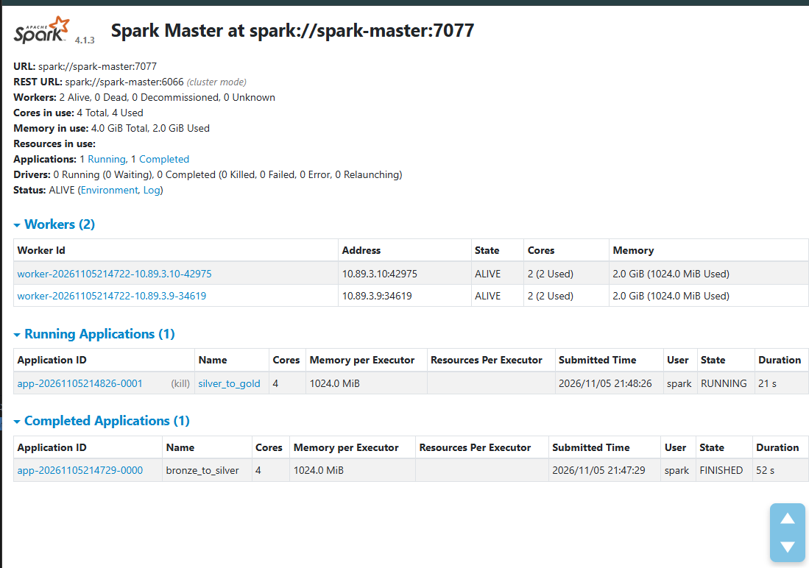
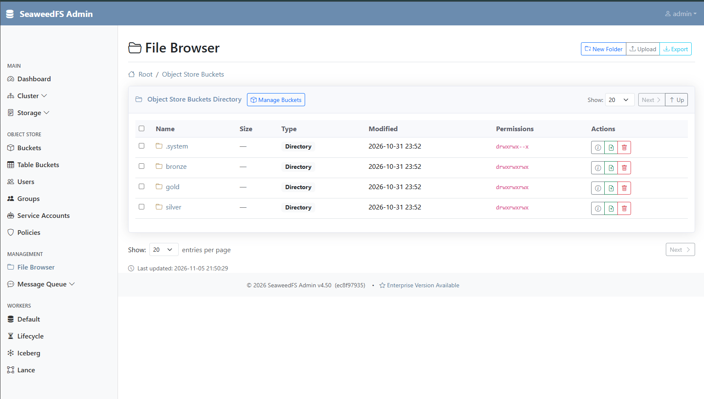
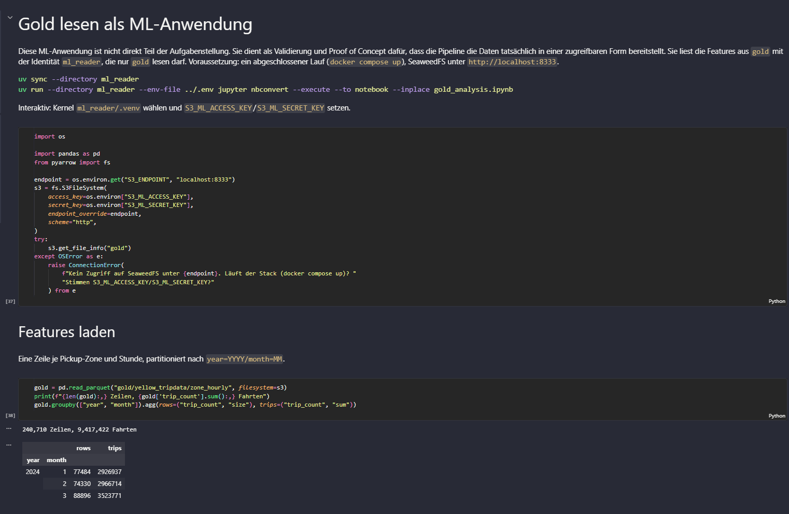
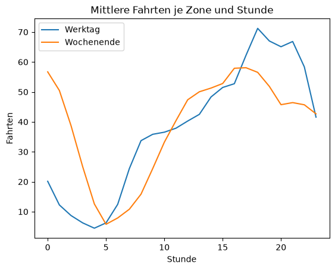

# Batch-Datenarchitektur für Taxinachfrage

Portfolio im Kurs Projekt: Data Engineering an der IU Internationale Hochschule.

- Name: Rahil Chughtai
- Kurs: Projekt: Data Engineering
- Kursnummer: DLMDWWDE02
- Aufgabe: 1.1, batch-basierte Datenarchitektur für eine datenintensive Applikation
- Datenquelle: [NYC TLC Yellow Taxi Trip Records](https://www.nyc.gov/site/tlc/about/tlc-trip-record-data.page)

## Konzept

Die Pipeline stellt einmal pro Quartal aufbereitete Trainingsdaten zur Taxinachfrage für eine
ML-Anwendung bereit. Sie folgt der Medallion-Architektur: Die Rohdaten der TLC landen unverändert
in **Bronze**, werden in **Silver** bereinigt und validiert und in **Gold** zur stündlichen
Nachfrage je Pickup-Zone aggregiert. Jeder Schritt ist ein eigener Container; `docker compose up`
führt einen vollständigen Lauf aus.

Anders als in der Konzeptionsphase geplant, braucht die Orchestrierung kein eigenes Python-Skript:
Docker Compose verkettet die Schritte selbst über `depends_on` mit
`service_completed_successfully`, startet jeden erst nach dem Erfolg des vorigen und hält die
Kette bei einem Fehler an.


Die editierbare Quelle des Diagramms liegt in [figures/architektur.drawio](figures/architektur.drawio).

## Datenfluss

| Schritt (Compose-Service) | Code | Liest | Schreibt |
|---|---|---|---|
| `lake-init` | [seaweedfs/init-buckets.py](seaweedfs/init-buckets.py) | – | Buckets `bronze`, `silver`, `gold` |
| `ingestion` | [services/ingestion/ingest.py](services/ingestion/ingest.py) | TLC-Monatsdateien | `bronze/yellow_tripdata/year=YYYY/month=MM/`, Manifest in `bronze/_manifests/yellow_tripdata/…` |
| `silver-job` | [services/spark/jobs/bronze_to_silver.py](services/spark/jobs/bronze_to_silver.py) | Bronze | `silver/yellow_tripdata/…`, abgelehnte Zeilen in `silver/_quarantine/yellow_tripdata/…` |
| `gold-job` | [services/spark/jobs/silver_to_gold.py](services/spark/jobs/silver_to_gold.py) | Silver | `gold/yellow_tripdata/zone_hourly/…` |
| `report` | [services/spark/jobs/report.py](services/spark/jobs/report.py) | alle Schichten | `gold/_reports/<INGEST_PERIOD>/`, lokal `runs/<INGEST_PERIOD>/` |

Die Schritte laufen in dieser Reihenfolge nacheinander. Dauerhaft laufen der Data Lake
`seaweedfs` (S3-kompatibler Objektspeicher) und der Spark-Cluster aus `spark-master` und zwei
`spark-worker`. `silver-job`, `gold-job` und `report` reichen ihr Skript per `spark-submit` beim
Cluster ein und beenden sich danach.

Alle drei Schichten sind nach `year=YYYY/month=MM` partitioniert; welche Monate ein Lauf
verarbeitet, bestimmt `INGEST_PERIOD` (siehe [Start](#start)). Zeitraum, Partitionsformat und Logging teilen sich Ingestion und
Spark über die Bibliothek [libs/pipeline_common](libs/pipeline_common/src/pipeline_common).

**Silver** übernimmt nur die für Nachfrage-Features nötigen Spalten, castet sie auf feste Typen
(die TLC ändert ihr Schema über die Jahre), entfernt exakte Duplikate und prüft zehn
Qualitätsregeln: fehlende Zeitstempel, Abholung außerhalb des Monats, negative oder über 24 Stunden
lange Fahrten, ungültige Distanzen und Beträge, Abholungen in den Zonen 264/265 („unbekannt“ und
„außerhalb NYC“, für die sich keine Nachfrage je Zone bilden lässt), ungültige Zielzonen und
Fahrgastzahlen. Abgelehnte Zeilen landen mit dem Namen der ersten verletzten Regel
(`reject_reason`) in der Quarantäne. `_source_file` und `_processed_at` halten fest, woher und
wann jede Zeile stammt.

**Gold** enthält eine Zeile je Pickup-Zone (1 bis 263) und Stunde des Monats: Anzahl
(`trip_count`), mittlere Distanz, Dauer und Beträge sowie Stunde, Wochentag und Wochenende als
Kalendermerkmale. Stunden ohne Fahrten stehen mit `trip_count = 0` und leeren Mittelwerten drin,
damit das Modell auch fehlende Nachfrage sieht.

**Der Laufbericht** zählt je Monat die Zeilen aller Schichten (`bronze_rows`, `silver_rows`,
`quarantined_rows` mit `rejected_by_reason`, `duplicates`, `gold_rows`, `gold_trips`). Er wird aus
den Daten selbst abgeleitet, deshalb muss `bronze_rows = silver_rows + quarantined_rows +
duplicates` und `gold_trips = silver_rows` gelten. Aus den Zeitstempeln der Stufen ergeben sich die
Latenzen `bronze_to_silver_s` und `silver_to_gold_s` sowie die Gesamtlaufzeit `pipeline_s` (erste
Quelldatei in Bronze bis letzte Gold-Partition). Liegt eine Quelldatei schon aus einem früheren
Lauf in Bronze, zählt `bronze_to_silver_s` ab diesem ersten Ablegen. Aus dem Manifest der
Ingestion übernimmt er je Monat SHA-256 und Last-Modified der Quelldatei, also welche
Quellversion verarbeitet wurde. Der Bericht liegt im Lake und
als `report.json` und `report.md` unter `runs/<INGEST_PERIOD>/` im Repository (von Git ignoriert);
ein neuer Lauf desselben Zeitraums überschreibt ihn.

## Start

Voraussetzungen: Docker mit `docker compose` oder [Podman](https://podman.io/) mit
`podman compose` und mindestens 8 GB RAM für die Container (Master, zwei Worker mit je 2 GiB und
der Driver). Bei weniger RAM lassen sich `SPARK_WORKER_MEMORY` und `SPARK_EXECUTOR_MEMORY` in
`.env` senken.

```sh
cp .env.example .env        # Zeitraum und Zugangsdaten in .env festlegen
docker compose up --build   # vollständiger Lauf
docker compose down         # beenden; Daten bleiben im Volume, docker compose up -d seaweedfs macht sie wieder lesbar
```

Den Zeitraum eines Laufs legt `INGEST_PERIOD` in `.env` fest (Pflicht, Beispielwert `2024Q1`):

| Variante | Format | Beispiel | Verarbeitet |
|---|---|---|---|
| Quartal | `YYYYQn` oder `YYYY-Qn` (`n` = 1–4) | `2024Q1` | Januar bis März 2024; der reguläre Lauf |
| Monat | `YYYY-MM` | `2024-03` | nur März 2024, etwa um einen Monat neu zu verarbeiten |

Der Zeitraum muss bei der TLC schon veröffentlicht sein, sonst bricht die Ingestion ab. Weitere
Worker startet `docker compose up --scale spark-worker=N`. `--build` sorgt dafür, dass ein Lauf
den aktuellen Code verwendet, weil die Image-Tags gleich bleiben. Nach dem Lauf laufen SeaweedFS
(`http://127.0.0.1:8333`) und der Spark-Cluster (UI unter `http://127.0.0.1:8080`) weiter, damit
die ML-Anwendung Gold lesen kann.



Zum Ansehen des Data Lakes gibt es alternativ auch die Admin-Oberfläche von SeaweedFS (Cluster, Volumes,
Dateibrowser über alle Buckets). Sie startet nur auf Anfrage und verlangt die Admin-Identität aus
`.env` (`S3_ADMIN_ACCESS_KEY` als Benutzer, `S3_ADMIN_SECRET_KEY` als Passwort):

```sh
docker compose --profile admin up -d seaweedfs-admin   # danach http://127.0.0.1:12535
docker compose --profile admin stop seaweedfs-admin
```



### Gold lesen (ML-Anwendung)

[ml_reader/gold_analysis.ipynb](ml_reader/gold_analysis.ipynb) zeigt, wie die ML-Anwendung die
Features mit der Identität `ml_reader` per pandas und pyarrow aus `gold/yellow_tripdata/zone_hourly/` liest,
die Aktualität im Laufbericht prüft und eine einfache Analyse macht. Der letzte Schritt belegt,
dass `ml_reader` Silver nicht lesen darf.

```sh
uv sync --directory ml_reader
uv run --directory ml_reader --env-file ../.env jupyter nbconvert --execute --to notebook --inplace gold_analysis.ipynb
```

Ausschnitt des Notebooks nach einem Lauf für `2024Q1` (Verbindung als `ml_reader`, Gold je Monat)
und die mittlere stündliche Nachfrage je Zone an Werktagen und am Wochenende:





## Umsetzung der Anforderungen

**Verlässlichkeit**

- Idempotent: Jeder Spark-Job überschreibt genau die Monats-Partition, die er verarbeitet; ein
  erneuter Lauf ersetzt sie, statt Zeilen zu verdoppeln. Die Ingestion legt ein Objekt erst nach
  vollständigem Upload an und überspringt einen Monat nur, wenn ETag und Last-Modified der Quelle
  noch zum Manifest passen; eine geänderte Quelldatei lädt sie neu.
- Wiederholungen bei Verbindungsfehlern und HTTP 429/5xx beim Download.
- Healthchecks für SeaweedFS und den Spark-Cluster; ein fehlgeschlagener Schritt beendet sich mit
  einem Fehler und hält die Kette an, statt neu zu starten (`restart: "no"`).
- Der Laufbericht macht die Vollständigkeit jedes Laufs prüfbar.

**Skalierbarkeit**

- Spark-Standalone-Cluster, horizontal skalierbar über weitere Worker
  (`docker compose up --scale spark-worker=N`).
- Monatsweise Partitionierung: Jeder Monat wird unabhängig verarbeitet und gelesen.

**Wartbarkeit**

- Ein Container je Aufgabe, ein kurzes Skript je Schicht.
- Versionierte Images, gesperrte Python-Abhängigkeiten je Service (`uv.lock`), Infrastruktur als
  Code in [docker-compose.yml](docker-compose.yml).
- Unit-Tests, End-to-End-Test und Linting in CI.

**Datensicherheit, Governance und Datenschutz**

- Least Privilege: Jeder Service bekommt nur die Zugangsdaten seiner eigenen Identität
  ([seaweedfs/s3.template.json](seaweedfs/s3.template.json)): Die Ingestion schreibt nur
  `bronze`, Spark liest `bronze` und schreibt `silver` und `gold`, die ML-Anwendung (`ml_reader`)
  liest nur `gold`. Die Spark-Worker selbst haben keine Zugangsdaten. Der End-to-End-Test prüft
  diese Rechte.
- Zugangsdaten stehen nur in `.env` (nicht im Repository). SeaweedFS startet nicht ohne
  Signing-Key, statt ohne Authentifizierung zu laufen; die gerenderte Schlüsseldatei ist nur für
  den Besitzer lesbar. Ingestion, `lake-init` und Spark laufen ohne Root-Rechte; SeaweedFS
  (offizielles Image) und `report` (schreibt in den Bind-Mount `./runs`) laufen als root.
- Datenminimierung in Silver, Quarantäne mit Ablehnungsgrund statt stillem Verwerfen, Herkunft
  jeder Zeile über `_source_file` und `_processed_at`. Je Monat hält ein Manifest in Bronze fest,
  welche Quelldatei geladen wurde: URL, ETag, Last-Modified, SHA-256, Größe und Ladezeitpunkt.

## Bekannte Grenzen

- **Keine Historie der Datenstände.** Ein Lauf überschreibt die Monate in Silver und Gold; ein
  früherer Stand lässt sich nicht wiederherstellen.
- **Kein atomarer Commit.** Wird ein Job mitten im Schreiben beendet, kann ein Monat unvollständig
  sein, bis ein erneuter Lauf ihn ersetzt.
- **Beispielschlüssel.** Die Werte aus `.env.example` reichen für eine lokale Demo; für jeden
  anderen Betrieb müssen sie durch eigene Zufallswerte ersetzt werden.

## Entwicklung

```sh
uv sync && uv run pre-commit install           # Ruff und pre-commit-Hooks
uv run --directory services/ingestion pytest   # Unit-Tests der Ingestion
uv run --directory services/spark pytest       # Unit-Tests der Spark-Jobs (braucht Java 17)
uv run --directory libs/pipeline_common pytest # Unit-Tests der Bibliothek
docker compose -f docker-compose.yml -f docker-compose.test.yml --env-file .env.example run --build --rm e2e-tests
docker compose -f docker-compose.yml -f docker-compose.test.yml --env-file .env.example down -v
```

Der End-to-End-Test ([tests/e2e](tests/e2e/test_pipeline.py)) startet dieselbe Pipeline mit einer
Mock-Quelle, die gekürzte echte TLC-Dateien (2.000 Fahrten je Monat, 2024Q1) ausliefert. Danach
prüft er: Bronze ist byte-gleich zur Quelle, Manifest und Laufbericht tragen ihre Checksumme, der
Laufbericht geht auf, jede Silver-Fahrt liegt in
ihrem Monat, jede Partition enthält genau eine Datei, und die Zugriffsrechte jeder Identität
entsprechen der Policy.

Der Workflow [tests.yml](.github/workflows/tests.yml) führt bei jedem Pull Request die Unit-Tests
und das Linting aus, den End-to-End-Test nach jedem Merge nach `develop` und `main` sowie beim
Release-PR nach `main`. Er läuft jeweils zweimal auf demselben Lake: Dieselben Prüfungen zeigen
dann, dass eine Wiederholung nichts verdoppelt.

## Troubleshooting

### Podman unter Windows: Ports vom Host nicht erreichbar

Die Pipeline läuft durch, aber `http://127.0.0.1:8333` und `http://127.0.0.1:8080` verweigern die
Verbindung. Ursache ist ein Fehler von Podman 6 mit der WSL-Weiterleitung im NAT-Modus
([microsoft/WSL#41204](https://github.com/microsoft/WSL/issues/41204)); neuere Machine-Images
bringen die Abhilfe schon mit. Für eine ältere rootful Machine:

```sh
podman machine ssh
mkdir -p /etc/containers/containers.rootful.conf.d
cat > /etc/containers/containers.rootful.conf.d/999-wsl-port-forwarding.conf <<'CONF'
[engine]
force_port_listen = true

[network]
default_host_ips = ["0.0.0.0"]
CONF
exit
podman machine stop
podman machine start
```

Für eine rootless Machine gilt dasselbe unter `/etc/containers/containers.rootless.conf.d/`.
Nicht `/etc/containers/containers.conf.d/` verwenden, das ist mit dem Windows-Client geteilt.

### Podman unter Windows: `failed to connect to the docker API at npipe`

`podman compose` bricht nach einem Windows-Neustart mit laufender Machine sofort ab, während
`podman ps` funktioniert. Ursache ist eine liegengebliebene Socket-Datei
([podman#29971](https://github.com/podman-container-tools/podman/issues/29971), behoben ab Podman
6.2.0). Abhilfe:

```powershell
podman machine stop
Remove-Item $env:TEMP\podman\podman-machine-default-api.sock
podman machine start
```
