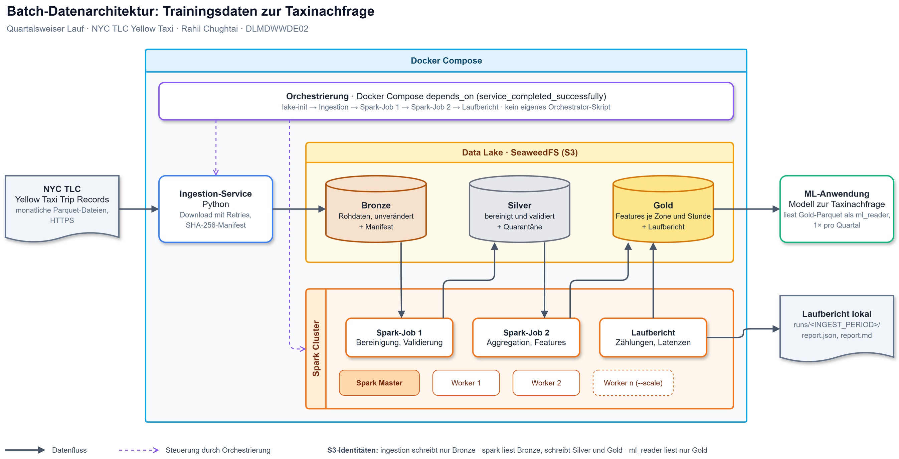

# Batch-Datenarchitektur für Taxinachfrage

Portfolio im Kurs Projekt: Data Engineering an der IU Internationale Hochschule.

- Name: Rahil Chughtai
- Kurs: Projekt: Data Engineering
- Kursnummer: DLMDWWDE02
- Aufgabe: 1.1, batch-basierte Datenarchitektur für eine datenintensive Applikation
- Datenquelle: [NYC TLC Yellow Taxi Trip Records](https://www.nyc.gov/site/tlc/about/tlc-trip-record-data.page)

## Konzept

Für das Projekt wurde Aufgabe 1.1 gewählt: Ziel ist eine Datenpipeline, die einmal pro Quartal aufbereitete Trainingsdaten zur Taxinachfrage für eine ML-Anwendung bereitstellt. Als Datenquelle dient der [NYC TLC Yellow Taxi Trip Datensatz](https://www.nyc.gov/site/tlc/about/tlc-trip-record-data.page), der detaillierte Aufzeichnungen von Taxifahrten veröffentlicht.

Das System ist eine containerisierte Batch-Pipeline aus unabhängig paketierten Jobs. Die Umgebung lässt sich über Docker Compose, Git und die gesperrten Python-Abhängigkeiten jedes Service (`uv.lock`) wiederholbar aufsetzen. Die Architektur gliedert sich in folgende Kernkomponenten:

* Ingestion & Storage: Ein Python-basierter Ingestion-Service lädt die historischen Monatsdaten herunter und speichert sie in einem S3-kompatiblen SeaweedFS-Objektspeicher, der als strukturierter Data Lake (Bronze-, Silver- und Gold-Layer) dient.
* Processing: Ein verteilter Apache-Spark-Cluster bereinigt und validiert die Millionen von Datensätzen und lässt sich durch zusätzliche Worker horizontal skalieren. Die aggregierten Features werden als optimierte Parquet-Dateien im Gold-Layer abgelegt und somit der ML-Anwendung bereitgestellt.
* Orchestrierung: Der Ablauf wird über ein modulares Python-Skript gesteuert, das die Services nacheinander startet.

Die Verlässlichkeit ergibt sich aus mehreren Bausteinen:

- idempotente Schritte: Ein erneuter Lauf überschreibt dieselben Monats-Partitionen.
- Retries beim Download und Upload der Ingestion.
- Healthchecks und eine Frist je Schritt im Orchestrator.
- Datenprüfungen mit Abgleich zwischen Silver und Gold.

Die Wartbarkeit sichern ein Service pro Container, versionierte Images und Abhängigkeiten sowie Tests und Linting in CI. Datenschutz und Governance werden durch Datenminimierung, getrennte Zugriffsrechte und Qualitätsprüfungen mit Quarantäne umgesetzt. Datenstände sind nachvollziehbar: Jede Zeile in Silver und Gold trägt die Run-ID ihres Laufs, und jeder Lauf schreibt einen Report. Bei einem Lauf über den Orchestrator verwenden er und alle drei Jobs dieselbe Run-ID, sodass sich sein Bericht, die Reports unter `_runs/` und die Spalte `_run_id` direkt verknüpfen lassen; manuell gestartete Einzeljobs erzeugen eine eigene. Ältere Datenstände werden nicht aufbewahrt (siehe [Bekannte Grenzen](#bekannte-grenzen)).

## Architektur



Die editierbare Quelle des Diagramms liegt in [figures/architektur.drawio](figures/architektur.drawio).

## Voraussetzungen

- [Podman](https://podman.io/) mit Compose-Provider (`podman compose`) oder alternativ Docker mit `docker compose`. Die Compose-Datei hält sich an die Compose-Spezifikation und läuft mit beiden.
- [uv](https://docs.astral.sh/uv/) für den Orchestrator und die lokale Entwicklung (Python 3.12).
- Mindestens 8 GB RAM für Container: Master, zwei Worker mit je 2 GiB und der Driver des Spark-Jobs. Bei einer Podman-Machine mit Hyper-V oder unter macOS mit `podman machine set --memory 8192` erhöhen. Unter WSL teilt sich die Machine den Speicher mit Windows.

Gemessen mit 2024Q1 (9,55 Mio. Fahrten): Im Data Lake liegen danach 160 MB Bronze, 203 MB Silver (inklusive Quarantäne) und 8,4 MB Gold. Ein erneuter Lauf desselben Quartals überschreibt die Partitionen und belegt keinen zusätzlichen Platz. Ohne Download braucht Job 1 12 bis 21 Sekunden je Monat, Job 2 6 bis 15 Sekunden. Bei weniger RAM lassen sich `SPARK_WORKER_MEMORY` und `SPARK_EXECUTOR_MEMORY` in `.env` senken.

## Start

```sh
cp .env.example .env        # Beispielwerte reichen für eine lokale Demo, sonst eigene Schlüssel setzen
uv run --project services/orchestrator orchestrator --quarter 2024Q1
```

Der [Orchestrator](services/orchestrator/README.md) baut die Images und führt Ingestion, Spark-Job 1 (`silver-job`) und Spark-Job 2 (`gold-job`) nacheinander für das angegebene Quartal aus. Er startet die benötigte Infrastruktur über Compose, bricht beim ersten Fehler ab und schreibt einen Laufbericht nach `runs/`. Den Compose-Befehl der eigenen Container-Engine gibt man über `COMPOSE_CMD` oder `--compose` an, z. B. `COMPOSE_CMD="podman compose"`. Einen Standardwert gibt es nicht. Die Spark-UI ist unter `http://127.0.0.1:8080` erreichbar.

Compose definiert die Container, nicht den Ablauf: `compose up` startet nur SeaweedFS, `lake-init` und den Spark-Cluster (Master und zwei Worker). Die drei Datenjobs liegen im Profil `jobs`, hängen nur von dieser Infrastruktur ab und lassen sich einzeln starten; Silver braucht bereits geladene Bronze-Daten, Gold bereits erzeugte Silver-Daten:

```sh
podman compose --profile jobs build                      # Images für Einzelläufe
podman compose run --rm ingestion --quarter 2024Q1
podman compose run --rm ingestion --month 2024-01 --force
podman compose run --rm silver-job --month 2024-01
podman compose run --rm gold-job --month 2024-01
podman compose up -d --scale spark-worker=3 spark-worker   # weitere Worker
podman compose down                                      # Infrastruktur beenden
```

Details zu Cluster, Qualitätsregeln und Reports: [services/spark/README.md](services/spark/README.md).

### Zeitraum und Laufbericht

Für reproduzierbare Demos wird ein explizites historisches Quartal wie `2024Q1` empfohlen. Ohne `--quarter` schätzt der Orchestrator das neueste veröffentlichte Quartal anhand der üblichen Veröffentlichungsverzögerung; `INGEST_PERIOD` aus `.env` wird dabei nicht verwendet. Diese Variable bleibt ein optionaler Fallback für manuelle Einzelläufe ohne `--quarter` oder `--month`. Der Orchestrator misst die Laufzeit jedes Schritts und läuft auf dem Host, weil ein Container dafür den Docker-Socket und damit root-äquivalente Rechte bräuchte.

```sh
uv run --project services/orchestrator orchestrator   # neuestes voraussichtlich veröffentlichtes Quartal
```

Gemessen mit 2024Q1 (Bronze schon geladen, Podman unter WSL): 118 Sekunden insgesamt, davon 44 Sekunden Ingestion inklusive Start von SeaweedFS, 40 Sekunden Job 1 und 28 Sekunden Job 2, jeweils mit Containerstart.

## Data Lake

| Bucket | Inhalt | Schreibt | Liest |
|---|---|---|---|
| `bronze` | TLC-Dateien unverändert, `yellow_tripdata/year=YYYY/month=MM/…parquet`, Laufprotokolle unter `_runs/` | ingestion | ingestion, spark |
| `silver` | bereinigte und validierte Fahrten `yellow_tripdata/year=YYYY/month=MM/`, abgelehnte Zeilen mit Grund unter `_quarantine/`, Qualitätsreports unter `_runs/` | spark | spark |
| `gold` | stündliche Nachfrage je Pickup-Zone mit Kalendermerkmalen `yellow_tripdata/zone_hourly/year=YYYY/month=MM/`, Reports unter `_runs/` | spark | spark, ml_reader |

Jeder Service bekommt in Compose nur die Zugangsdaten seiner eigenen Identität. Die Identitäten werden beim Start von SeaweedFS aus `.env` erzeugt ([seaweedfs/s3.json.template](seaweedfs/s3.json.template)). SeaweedFS 4.x verwirft die Identitäten ohne Signing-Key stillschweigend und läuft dann ohne Authentifizierung. Der Container startet deshalb nicht, wenn `SEAWEEDFS_SIGNING_KEY` fehlt oder kürzer als 32 Zeichen ist.

## Bekannte Grenzen

Die Pipeline ist für einen lokalen Einzelbetrieb ausgelegt. Bewusst nicht umgesetzt:

- **Keine Historie der Datenstände.** Bronze, Silver und Gold werden pro Monat überschrieben. Wiederholbar sind Deployment (Compose, Lockfiles, Image-Tags) und Läufe (idempotent), ein früherer Datenstand lässt sich aber nicht wiederherstellen. Erhalten bleiben nur die Reports unter `_runs/` mit Run-IDs, Zählern und Herkunft.
- **Gold kann hinter Silver zurückliegen.** Gold wird ohne eigene Veröffentlichungsstufe direkt überschrieben. Scheitert ein Lauf nach Job 1, liegt neues Silver neben älterem Gold. Ob Gold aktuell ist, zeigen der Laufbericht des Orchestrators und `silver_run_ids` im Gold-Report: Nach einem vollständigen Orchestrator-Lauf enthält es genau dessen Run-ID.
- **Kein atomarer Commit.** S3A ersetzt Partitionen per Kopieren und Löschen. Wird ein Job mitten im Schreiben beendet, kann ein Monat unvollständig sein, bis ein erneuter Lauf ihn ersetzt. Job 2 lehnt Silver ab, das Zeilen aus mehreren Läufen enthält.
- **Ein Lauf zur Zeit.** Parallele Läufe für überlappende Zeiträume werden nicht verhindert und überschreiben dieselben Partitionen. Run-IDs sind eindeutig, Reports kollidieren also nicht.
- **Leere Monate gelten als Fehler.** Hat ein Monat keine einzige gültige Fahrt, endet Job 1 mit `failed` und lässt den bisherigen Stand stehen. Eine Schwelle für den Anteil abgelehnter Zeilen gibt es nicht.
- **Beispielschlüssel.** Die Werte aus `.env.example` reichen für eine lokale Demo. Für jeden anderen Betrieb müssen sie durch eigene Zufallswerte ersetzt werden.
- **Podman nicht in CI.** Der End-to-End-Test in CI läuft mit Docker; Podman ist nur lokal getestet.

## Entwicklung

```sh
uv sync                                   # Dev-Tools (Ruff, pre-commit)
uv run pre-commit install                 # Hooks für jeden Commit
uv run ruff format . && uv run ruff check .
uv sync --directory services/ingestion    # Umgebung eines Service, z. B. für die IDE
uv run --directory services/ingestion pytest   # Unit-Tests eines Service
uv run --directory tests/e2e pytest -v    # End-to-End-Test (Docker; normale Umgebung vorher stoppen)
```

Die Spark-Tests brauchen Java 17; unter Windows laufen sie im Spark-Image (Befehl in [services/spark/README.md](services/spark/README.md#tests)).

Formatierung und Linting laufen zentral über Ruff (Konfiguration in [pyproject.toml](pyproject.toml)), dazu `.editorconfig` und LF-Zeilenenden über `.gitattributes`. Jeder Service ist ein eigenes uv-Projekt mit eigenem `uv.lock` und eigenen Tests unter `services/<name>/tests/`; pytest und Test-Hilfen stehen in der `dev`-Gruppe des Service und landen nicht im Image. Der Workflow [tests.yml](.github/workflows/tests.yml) läuft bei jedem Pull Request:

- `unit-tests`: die Unit-Tests, ein Matrix-Job pro Service.
- `lint`: `ruff check` und `ruff format --check`.
- `e2e`: der [End-to-End-Test](tests/e2e/README.md). Er ruft den echten Orchestrator auf, der die echten Images, SeaweedFS und den Spark-Cluster startet; die Ingestion lädt gekürzte echte TLC-Dateien aus dem Repository von einem Mock-Server. Geprüft werden ein Quartal durch alle Schichten, die Wiederholung, ein nicht veröffentlichtes Quartal und die Zugriffsrechte.

Der abschließende Job `tests-passed` ist nur grün, wenn Unit-Tests, Lint und der End-to-End-Test erfolgreich waren; er ist der Pflicht-Check für Merges nach `develop`. Weil der End-to-End-Test die Images baut, blockiert ein Ausfall von Docker Hub oder Maven Central auch den Merge.
